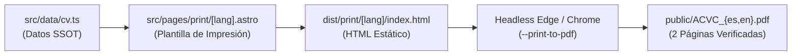

# Skill: Tune PDF Layout & Budget

Esta skill proporciona las directrices y técnicas de ingeniería de espacio para resolver desbordamientos de página en los currículums descargables en formato PDF (`public/ACVC_es.pdf` y `public/ACVC_en.pdf`), garantizando que ambos documentos se mantengan dentro del **límite estricto de exactamente 2 páginas**.

---

## 1. El Invariante del Presupuesto de Páginas

El script de compilación [scripts/generate-pdf.mjs](file:///c:/Users/anaca/Repos/anacatalina-cv/scripts/generate-pdf.mjs) valida de forma automática e inflexible:

$$\text{Páginas}(ACVC\_es.pdf) = 2 \quad \land \quad \text{Páginas}(ACVC\_en.pdf) = 2$$

Si la cantidad de texto o los espaciados hacen que el contenido pase a una 3ª página (aunque sea por una sola línea huérfana), el script aborta la compilación con un error:
```
Page count mismatch for public/ACVC_es.pdf: Expected 2 pages, but got 3 pages!
```

---

## 2. Arquitectura de Renderizado del PDF



---

## 3. Estrategia de Ajuste en 3 Palancas

Cuando un cambio en la experiencia laboral, educación o habilidades genere un desbordamiento a 3 páginas, aplica las siguientes tres palancas en orden de precedencia:

### Palanca 1: Asimetría Intencional en el Contenido (`src/data/cv.ts`) — [RECOMENDADA]

La web interactiva y el PDF tienen objetivos editoriales diferentes:
- **La Web (`bullets`, `skills`, `details`):** Es un portafolio expansivo que puede contener todos los detalles y herramientas que desees.
- **El PDF (`pdfBullets`, `pdfFormatted`, `pdfDetails`):** Es un documento ejecutivo ultra-condensado.

**Acciones de condensación en `src/data/cv.ts`:**
1. **Fusionar viñetas afines en `pdfBullets`:** Si un rol tiene 4 viñetas en la web, sintetízalas en 2 o 3 viñetas potentes en `pdfBullets` combinando el reto técnico y su métrica de impacto.
   - *Ejemplo Web (2 viñetas):*
     - Viñeta 1: *"Diseño de arquitectura de microservicios en FastAPI para el motor de ruteo..."*
     - Viñeta 2: *"Optimización de consultas SQL en PostgreSQL reduciendo tiempos de latencia en 35%..."*
   - *Ejemplo PDF (1 viñeta fusionada):*
     - *"Diseño de microservicios en FastAPI y optimización de consultas PostgreSQL, reduciendo tiempos de latencia en 35%..."*
2. **Compactar líneas de habilidades en `pdfFormatted`:** En lugar de listar cada sub-librería en el PDF, agrupa por categorías paraguas (ej. *"PyTorch, Scikit-Learn, Pandas, Polars"* en vez de 10 librerías auxiliares).
3. **Condensar `pdfDetails` en educación:** Eliminar menciones extensas de cursos menores o tesinas secundarias en el PDF, reservándolas para la web.

### Palanca 2: Afinación de Variables Tipográficas y Espaciados (`src/pages/print/[lang].astro`)

Si el contenido redactado ya es óptimo y la 3ª página se produce por apenas 1 a 3 líneas, ajusta los parámetros de estilo en `src/pages/print/[lang].astro`:

1. **Márgenes de Página (`@page`):**
   ```css
   @page {
     size: letter;
     /* Por defecto: margin: 0.65in 0.8in 0.5in 0.8in; */
     /* Si se desborda, reducir suavemente los márgenes superior e inferior: */
     margin: 0.55in 0.75in 0.45in 0.75in;
   }
   ```
2. **Interlineado (`line-height`) y Tamaño de Fuente (`font-size`):**
   ```css
   body {
     /* Por defecto: font-size: 10pt; line-height: 1.33; */
     font-size: 9.8pt;      /* o 9.5pt en casos de alta densidad */
     line-height: 1.28;     /* reduce la altura de párrafo sin perder legibilidad */
   }
   ```
3. **Separación entre Secciones (`.section`) y Bloques (`.experience-item`):**
   ```css
   .section {
     margin-bottom: 0.7rem; /* reducción de 0.85rem a 0.7rem */
   }
   .experience-item {
     margin-bottom: 0.55rem; /* reducción de 0.65rem a 0.55rem */
   }
   ul.bullet-list li {
     margin-bottom: 0.15rem; /* reducción de 0.25rem a 0.15rem */
   }
   ```

> [!IMPORTANT]
> Mantén la regla `page-break-inside: avoid;` en `.experience-item` y `.education-item`. Esto evita que un rol laboral quede cortado a la mitad entre la página 1 y la 2.

### Palanca 3: Verificación Automatizada y Control de Calidad

Ejecuta el pipeline de compilación para comprobar el resultado:

```powershell
npm run build:pdf
```

- Si el comando finaliza con:
  `✓ Successfully generated ACVC_es.pdf (2 pages verified)`
  `✓ Successfully generated ACVC_en.pdf (2 pages verified)`
  el presupuesto ha sido respetado.
- Abre ambos PDFs para verificar que la página 2 termine de manera balanceada y que no queden espacios en blanco desproporcionados ni elementos superpuestos.

---

## 4. Checklist de Diagnóstico Rápido

- [ ] ¿Ambos idiomas (`es` y `en`) compilan exactamente a 2 páginas? (El inglés suele ser entre un 10% y 15% más corto que el español; asegúrate de que ambos mantengan el equilibrio).
- [ ] ¿Se preservaron las métricas e impacto clave al condensar `pdfBullets`?
- [ ] ¿Hay coherencia factual total entre la versión web y la versión PDF (cero contradicciones en fechas, títulos, empresas y tecnologías)?
- [ ] ¿Se verificó que los archivos en `public/ACVC_es.pdf` y `public/ACVC_en.pdf` tengan una marca temporal (*mtime*) actualizada?
