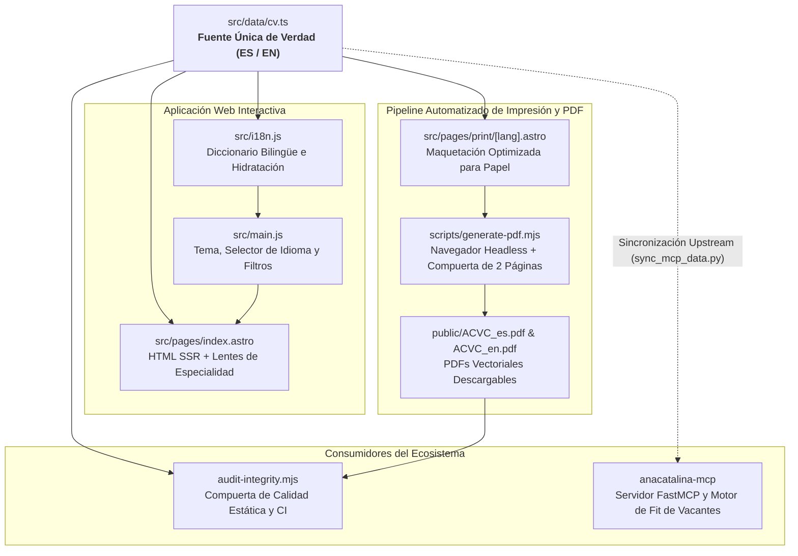

<p align="center">
  
</p>

# Ana-Catalina Villalobos — CV Profesional y Portafolio

> **Portafolio de carrera interactivo bilingüe y currículum vitae automatizado en PDF de 2 páginas optimizado para ATS, impulsado por una Fuente Única de Verdad (SSOT) en Astro 6 y TypeScript.**

[English](README.md) | [Español](README.es.md)


Demo en vivo: [cv.ana-catalina.com](https://cv.ana-catalina.com)

---

## Resumen

`anacatalina-cv` es la Fuente Única de Verdad (SSOT) canónica sobre la trayectoria profesional, formación académica y taxonomía de habilidades técnicas de **Ana-Catalina Alejandra Villalobos Contardo**, Ingeniera Civil y Data Scientist / Machine Learning Engineer.

Dentro del ecosistema de ingeniería de cuatro nodos bajo el dominio `ana-catalina.com`, este repositorio cumple dos misiones estrechamente acopladas a partir de un único modelo de datos fuertemente tipado (`src/data/cv.ts`):
1. **Portafolio Web Interactivo (`cv.ana-catalina.com`):** Una aplicación de página única (SPA) responsiva, accesible y bilingüe (`ES`/`EN`) con soporte para modo oscuro, lentes interactivos de especialidad técnica y contexto arquitectónico detallado.
2. **CV Imprimible Oficial de 2 Páginas (`ACVC_es.pdf` y `ACVC_en.pdf`):** Documentos PDF vectoriales de alto contraste y compatibles con sistemas ATS, compilados automáticamente desde rutas Astro de impresión (`src/pages/print/[lang].astro`) mediante Chromium/Edge headless y validados bajo un presupuesto estricto de 2 páginas.

### Características Principales

- **Fuente Única de Verdad Fuertemente Tipada (`src/data/cv.ts`):** Centraliza experiencia laboral, logros cuantificados, credenciales académicas, publicaciones científicas y categorías de habilidades en un contrato TypeScript bilingüe (`{ es, en }`).
- **Granularidad Intencional Web vs. PDF:** Permite desplegar narrativas arquitectónicas detalladas en la web interactiva (`summary.web`, `bullets`, `skills`) junto con síntesis ejecutivas condensadas para el PDF descargable (`summary.pdf`, `pdfBullets`, `pdfFormatted`), garantizando cero contradicciones fácticas.
- **Lentes Interactivos de Especialidad Técnica:** Permite a reclutadores y líderes de ingeniería filtrar dinámicamente la taxonomía de habilidades por dominio (`IA & Machine Learning`, `Data Platform & Cloud`, `Ingeniería de Software`, `Liderazgo & Arquitectura`) mediante controles en la interfaz o parámetros de URL (`?focus=ai-ml`, `?track=data-cloud`).
- **Pipeline Automatizado de PDF Headless y Compuerta de 2 Páginas:** Compila plantillas estáticas de impresión (`dist/print/es/index.html`, `dist/print/en/index.html`) y genera PDFs vectoriales vía navegador headless verificando estrictamente el límite de 2 páginas y actualizando automáticamente el parámetro de versión ISO (`?v=YYYY-MM-DD`).
- **Arquitectura Cliente sin Dependencias de Runtime:** Construida con JavaScript ES6+ nativo (`src/main.js`) para cambio instantáneo de idioma (`localStorage.lang`), persistencia de tema (`localStorage.theme`) y animaciones de entrada al hacer scroll.
- **Auditoría Estática de Integridad y Sincronización del Ecosistema:** Incluye herramientas CLI automatizadas para validar paridad bilingüe, enlaces `data-i18n` en el DOM, la regla Zero Flags, conteo de páginas PDF (`npm run audit:integrity`) y detección de logros en repositorios locales (`npm run audit:activity`).

### Estructura de Componentes



| Componente | Responsabilidad |
| :--- | :--- |
| `src/data/cv.ts` | Fuente Única de Verdad (SSOT) canónica que define todas las entidades bilingües del CV, la fecha de versión (`lastUpdated`), las narrativas web y los campos condensados para PDF. |
| `src/pages/index.astro` | Página principal interactiva del portafolio que renderiza la sección hero, línea de tiempo profesional, tarjetas filtrables de habilidades, educación y publicaciones científicas. |
| `src/pages/print/[lang].astro` | Ruta dinámica Astro de impresión (`/print/es`, `/print/en`) diseñada para legibilidad en papel blanco, lectura lineal por parsers ATS y paginación exacta en 2 páginas. |
| `src/i18n.js` | Diccionario de traducciones bilingüe hidratado dinámicamente desde `src/data/cv.ts` y enlazado al DOM mediante `data-i18n`, `data-i18n-href` y `data-i18n-aria`. |
| `src/main.js` | Controlador cliente que gestiona el cambio instantáneo `ES`/`EN`, alternancia de modo claro/oscuro, menú móvil, barra de progreso de lectura y lentes de habilidades. |
| `src/layouts/Layout.astro` | Estructura HTML compartida con metadatos SEO/Open Graph, datos estructurados JSON-LD (`Person`), inicialización de tema sin parpadeo, `Navbar.astro` y `Footer.astro`. |
| `scripts/generate-pdf.mjs` | Script de automatización que sincroniza `cvData.meta.lastUpdated`, ejecuta `astro build`, renderiza ambos PDFs con navegador headless y verifica el límite de 2 páginas. |
| `.agents/skills/` | Skills de automatización del espacio de trabajo para auditoría estática (`audit-cv-integrity`), escaneo de logros en repositorios (`sync-cv`) y ajuste de layout de impresión (`tune-pdf-layout`). |

### Stack Tecnológico

- **Framework y Empaquetador:** [Astro 6](https://astro.build/) (Generación de Sitios Estáticos, optimización de imágenes en build con `astro:assets`, `@astrojs/sitemap`)
- **Lenguajes y Tipado:** TypeScript 5.9, Vanilla JavaScript (ES6+)
- **Estilos y Sistema de Diseño:** [Tailwind CSS v4](https://tailwindcss.com/) (configuración CSS-first vía `@tailwindcss/vite`, paleta Pastel-Tech personalizada, modo oscuro mediante `@custom-variant dark`)
- **Tipografía:** Google Fonts — `Outfit` (encabezados geométricos) e `Inter` (cuerpo de lectura y plantilla de impresión)
- **Toolchain de Renderizado PDF:** CLI Headless de Chromium / Microsoft Edge / Google Chrome con validación automatizada de páginas sobre el buffer del PDF
- **Despliegue y Analítica:** Vercel (`@vercel/analytics`), GitHub Actions CI (`ubuntu-latest`, Node.js 22)

### Compilación y Ejecución

#### Requisitos Previos

- **Node.js:** `v20+` (se recomienda `v22 LTS`)
- **Navegador Headless (solo para regenerar los PDFs localmente):** Microsoft Edge, Google Chrome o Chromium instalado en el sistema (o configurado mediante la variable de entorno `CHROME_PATH`)

#### Instalación y Servidor de Desarrollo

```bash
# 1. Clonar el repositorio
git clone https://github.com/AnaCataVC/anacatalina-cv.git
cd anacatalina-cv

# 2. Instalar dependencias
npm install

# 3. Iniciar el servidor de desarrollo local de Astro (http://localhost:4321)
npm run dev
```

#### Compilación de Producción y Regeneración de PDFs

```bash
# Verificar tipos con astro check y compilar el sitio estático de producción en ./dist/
npm run build

# Sincronizar cvData.meta.lastUpdated, compilar rutas de impresión y generar los PDFs de 2 páginas en ./public/
npm run build:pdf

# Previsualizar el build de producción localmente
npm run preview
```

### Pruebas Automatizadas y Compuertas de Calidad

El repositorio ejecuta un pipeline de verificación multicapa tanto en entorno local como en GitHub Actions CI (`.github/workflows/ci.yml`):

```bash
# 1. Ejecutar la suite de auditoría estática de integridad (paridad bilingüe SSOT, enlaces DOM i18n,
#    llaves huérfanas, regla Zero Flags, invariantes de identidad y conteo de 2 páginas en buffer PDF)
npm run audit:integrity

# 2. Ejecutar diagnóstico estricto de tipos Astro/TypeScript y compilación de producción
npm run build

# 3. Escanear repositorios git personales y laborales recientes para detectar nuevos logros técnicos
npm run audit:activity
```

### Decisiones de Arquitectura y Aprendizajes

1. **Fuente Única de Verdad con Asimetría Intencional Web/PDF:**
   Las primeras versiones del CV sufrían desfasajes entre el sitio web HTML y los documentos externos en Word/LaTeX. Centralizar todo el contenido en `src/data/cv.ts` eliminó la duplicación e introdujo campos explícitos de doble granularidad (`bullets` vs. `pdfBullets`, `summary.web` vs. `summary.pdf`). Esto permite que la web funcione como un portafolio técnico detallado mientras el PDF descargable mantiene una síntesis ejecutiva estrictamente acotada a 2 páginas sin contradicciones fácticas.
2. **Pipeline PDF Headless sin Dependencias Pesadas y Compuerta de 2 Páginas:**
   En lugar de incorporar binarios pesados de Puppeteer/Playwright en `node_modules` o depender de `window.print()` en el navegador del usuario, `scripts/generate-pdf.mjs` invoca el binario nativo del sistema (Edge, Chrome o Chromium) en modo headless sobre las rutas compiladas `/print/es` y `/print/en`. El script inspecciona el flujo binario del PDF (`/\/Type\s*\/Page\b/g`) para exigir exactamente 2 páginas, mientras que `audit-integrity.mjs` replica esta verificación binaria en Linux CI sin requerir navegador instalado.
3. **Invariante de Cache-Busting de PDF en Dispositivos Móviles (Android / Samsung One UI):**
   Los navegadores móviles y visores PDF nativos en Android almacenan agresivamente en caché las descargas PDF por URL e ignoran con frecuencia las cabeceras HTTP `Cache-Control: must-revalidate`. Para garantizar que los reclutadores siempre abran la versión vigente, `scripts/generate-pdf.mjs` actualiza `cvData.meta.lastUpdated` (`YYYY-MM-DD`) antes de ejecutar `astro build`, propagando el parámetro `?v=YYYY-MM-DD` tanto en el HTML SSR como en el diccionario cliente `src/i18n.js`.
4. **Contrato de Ecosistema Inter-Repositorio (`anacatalina-mcp` y `projects-hub`):**
   `anacatalina-cv` actúa como proveedor upstream de datos biográficos y habilidades para el servidor FastMCP del portafolio (`anacatalina-mcp`). Mantener identificadores estables de roles en `src/data/cv.ts` y categorías semánticas en `src/pages/index.astro` permite auditar y sincronizar automáticamente los datos aguas abajo (`sync_mcp_data.py --audit`) para evaluación de alineación con vacantes mediante IA.

## Licencia

Este proyecto está bajo la Licencia MIT. Consulta el archivo [LICENSE](LICENSE) para más detalles.

> 💡 **¿Quieres armar tu propio CV?** Existe una plantilla base de código abierto basada en la arquitectura original de este sitio disponible para explorar y personalizar en [AnaCataVC/my-cv](https://github.com/AnaCataVC/my-cv/) (repositorio de plantilla archivado).
