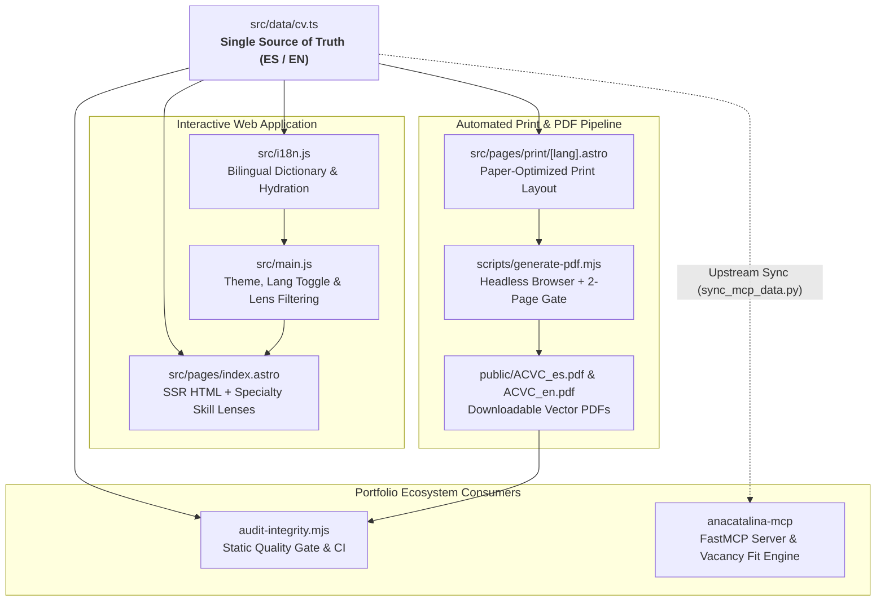

<p align="center">
  
</p>

# Ana-Catalina Villalobos — Professional CV & Portfolio

> **Bilingual interactive career portfolio and automated 2-page ATS-ready PDF curriculum vitae powered by a Single Source of Truth (SSOT) in Astro 6 and TypeScript.**

[English](README.md) | [Español](README.es.md)


Live demo: [cv.ana-catalina.com](https://cv.ana-catalina.com)

---

## Overview

`anacatalina-cv` is the canonical biographical, career trajectory, and technical skills Single Source of Truth (SSOT) for **Ana-Catalina Alejandra Villalobos Contardo**, Civil Engineer and Data Scientist / Machine Learning Engineer.

Within the `ana-catalina.com` four-node engineering ecosystem, this repository serves two tightly coupled missions from a single strongly typed dataset (`src/data/cv.ts`):
1. **Interactive Web Portfolio (`cv.ana-catalina.com`):** A responsive, accessible, bilingual (`ES`/`EN`) single-page application featuring dark mode, interactive specialty skill lenses, and rich architectural context.
2. **Authoritative 2-Page Print CV (`ACVC_es.pdf` & `ACVC_en.pdf`):** High-contrast, ATS-friendly vector PDF documents compiled automatically from print-specific Astro routes (`src/pages/print/[lang].astro`) via headless Chromium/Edge and validated against a strict 2-page budget gate.

### Key Features

- **Strongly Typed Single Source of Truth (`src/data/cv.ts`):** Centralizes employment history, quantified achievements, academic credentials, scientific publications, and categorized skills in a bilingual (`{ es, en }`) TypeScript contract.
- **Intentional Web vs. PDF Granularity:** Supports rich narrative context on the interactive web (`summary.web`, `bullets`, `skills`) alongside synthesized executive phrasing for the downloadable PDF (`summary.pdf`, `pdfBullets`, `pdfFormatted`) with zero factual contradictions.
- **Interactive Specialty Skill Lenses:** Allows recruiters and engineering managers to dynamically filter the technical skills taxonomy by domain (`AI & Machine Learning`, `Data Platform & Cloud`, `Software Engineering`, `Leadership & Architecture`) via UI pills or URL query parameters (`?focus=ai-ml`, `?track=data-cloud`).
- **Automated Headless PDF Pipeline & 2-Page Gate:** Compiles static print templates (`dist/print/es/index.html`, `dist/print/en/index.html`) and renders vector PDFs via headless browser while enforcing a hard 2-page count check and automatic ISO date cache-busting (`?v=YYYY-MM-DD`).
- **Zero-Runtime-Dependency Client Architecture:** Built with vanilla ES6+ JavaScript (`src/main.js`) for instantaneous client-side language switching (`localStorage.lang`), theme persistence (`localStorage.theme`), and scroll-triggered reveal animations.
- **Static Integrity & Ecosystem Auditing:** Ships with automated CLI scripts to verify bilingual parity, DOM `data-i18n` bindings, the Zero Flags Rule, PDF page counts (`npm run audit:integrity`), and cross-repository activity scanning (`npm run audit:activity`).

### Architecture Overview



| Component | Responsibility |
| :--- | :--- |
| `src/data/cv.ts` | Canonical Single Source of Truth (SSOT) defining all bilingual CV entities, metadata version date (`lastUpdated`), web narratives, and condensed PDF fields. |
| `src/pages/index.astro` | Main interactive portfolio page rendering the hero section, career timeline, filterable skill cards, education, and scientific publications. |
| `src/pages/print/[lang].astro` | Print-specific Astro dynamic route (`/print/es`, `/print/en`) styled for physical readability, ATS linear parsing, and strict 2-page pagination. |
| `src/i18n.js` | Bilingual translation dictionary dynamically hydrated from `src/data/cv.ts` and bound to DOM elements via `data-i18n`, `data-i18n-href`, and `data-i18n-aria`. |
| `src/main.js` | Client-side controller managing instant `ES`/`EN` switching, light/dark mode toggles, mobile navigation, scroll progress, and specialty skill lenses. |
| `src/layouts/Layout.astro` | Shared document shell providing SEO/Open Graph tags, JSON-LD `Person` structured data, flash-free theme initialization, `Navbar.astro`, and `Footer.astro`. |
| `scripts/generate-pdf.mjs` | Build automation script that updates `cvData.meta.lastUpdated`, runs `astro build`, renders both PDFs via headless browser, and verifies the 2-page budget. |
| `.agents/skills/` | Workspace automation skills for static integrity verification (`audit-cv-integrity`), git repository achievement scanning (`sync-cv`), and print layout tuning (`tune-pdf-layout`). |

### Tech Stack

- **Framework & Bundler:** [Astro 6](https://astro.build/) (Static Site Generation, `astro:assets` build-time image optimization, `@astrojs/sitemap`)
- **Language & Typing:** TypeScript 5.9, Vanilla JavaScript (ES6+)
- **Styling & Design System:** [Tailwind CSS v4](https://tailwindcss.com/) (`@tailwindcss/vite` CSS-first configuration, custom Pastel-Tech palette, dark mode via `@custom-variant dark`)
- **Typography:** Google Fonts — `Outfit` (geometric headings) and `Inter` (crisp body and print copy)
- **PDF Rendering Toolchain:** Headless Chromium / Microsoft Edge / Google Chrome CLI with automated PDF buffer page-count verification
- **Deployment & Analytics:** Vercel (`@vercel/analytics`), GitHub Actions CI (`ubuntu-latest`, Node.js 22)

### Getting Started

#### Prerequisites

- **Node.js:** `v20+` (`v22 LTS` recommended)
- **Headless Browser (for local PDF regeneration only):** Microsoft Edge, Google Chrome, or Chromium installed locally (or specified via the `CHROME_PATH` environment variable)

#### Installation & Local Development

```bash
# 1. Clone the repository
git clone https://github.com/AnaCataVC/anacatalina-cv.git
cd anacatalina-cv

# 2. Install dependencies
npm install

# 3. Start the local Astro development server (http://localhost:4321)
npm run dev
```

#### Building & Regenerating Downloadable PDFs

```bash
# Type-check with astro check and compile production static site to ./dist/
npm run build

# Update cvData.meta.lastUpdated, build print routes, and render 2-page PDFs to ./public/
npm run build:pdf

# Preview the production build locally
npm run preview
```

### Automated Testing & Quality Gates

The repository enforces a multi-stage verification pipeline locally and in GitHub Actions CI (`.github/workflows/ci.yml`):

```bash
# 1. Run the static integrity suite (SSOT bilingual parity, DOM i18n bindings,
#    orphaned keys, Zero Flags Rule, identity invariants, and PDF 2-page buffer check)
npm run audit:integrity

# 2. Run Astro & TypeScript strict diagnostics and production build
npm run build

# 3. Scan recent personal and workplace git repositories for new CV achievements
npm run audit:activity
```

### Key Learnings & Architectural Decisions

1. **Single Source of Truth with Intentional Web/PDF Asymmetry:**
   Early iterations of the CV suffered from drift between the HTML website and external Word/LaTeX PDF files. Centralizing all content in `src/data/cv.ts` eliminated duplication while introducing explicit dual-granularity fields (`bullets` vs. `pdfBullets`, `summary.web` vs. `summary.pdf`). This allows the website to act as an expansive engineering portfolio while keeping the print PDF executive and strictly bounded to 2 pages without factual divergence.
2. **Zero-Dependency Headless Browser PDF Pipeline with 2-Page Gate:**
   Instead of bundling heavy Puppeteer/Playwright binaries in `node_modules` or relying on client-side `window.print()`, `scripts/generate-pdf.mjs` invokes the system's native Chromium/Edge binary in headless mode against compiled `/print/es` and `/print/en` routes. The script inspects the resulting PDF byte stream (`/\/Type\s*\/Page\b/g`) to enforce a hard 2-page budget, while `audit-integrity.mjs` repeats this binary buffer check in Linux CI without requiring a browser installation.
3. **Mobile PDF Cache-Busting Invariant (Android / Samsung One UI):**
   Mobile browsers and native Android PDF viewers aggressively cache downloaded PDFs by URL and frequently ignore HTTP `Cache-Control: must-revalidate` headers. To guarantee recruiters always open the latest document, `scripts/generate-pdf.mjs` stamps `cvData.meta.lastUpdated` (`YYYY-MM-DD`) before `astro build`, binding `?v=YYYY-MM-DD` across both SSR HTML links and client-side `src/i18n.js` dictionaries.
4. **Cross-Repository Ecosystem Contract (`anacatalina-mcp` & `projects-hub`):**
   `anacatalina-cv` operates as the upstream biographical and skills provider for the portfolio's FastMCP server (`anacatalina-mcp`). Preserving stable role identifiers in `src/data/cv.ts` and semantic skill categories in `src/pages/index.astro` enables automated downstream synchronization (`sync_mcp_data.py --audit`) and real-time AI vacancy alignment evaluation.

## License

This project is licensed under the MIT License. See [LICENSE](LICENSE) for details.

> 💡 **Looking to build your own CV?** An open-source starter template based on the original architecture of this site is available to explore and customize at [AnaCataVC/my-cv](https://github.com/AnaCataVC/my-cv/) (archived template repository).
